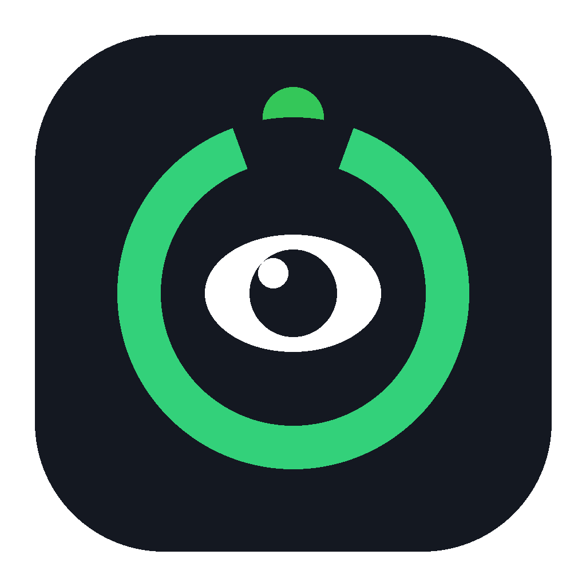

# EyeGuard · 强制休息护眼提醒


> **自律辅助软件**：本工具为帮助自己控制长时间玩游戏的用户而写。
> **所有行为 100% 在本机执行，绝对不联网、不收集、不上传任何数据**，没有统计、没有更新检查、
> 没有账号、没有任何网络请求代码。日志只会写在你本地的 `eyeguard.log` 里。

一个很小的 Windows 桌面程序：每玩一段时间，用一个**全屏、不可随手关掉**的倒计时提醒你
抬头看看 6 米以外的地方。单文件 `main.py`，纯 Python 标准库，**零第三方依赖**。



```text
┌─ 常驻浮窗 ──────────┐   ┌─ 提前预警 ──────────┐   ┌─ 全屏提醒（25 秒） ────────┐
│  距下次休息        │   │  30 秒后该看外面啦  │   │  你已经玩了 20 分钟，      │
│    19:47           │ → │    00:30           │ → │  为了眼睛，去看看外面吧！  │
│   ─────────        │   │  （变色闪烁）      │   │      ◜ 25s ◝ 环形倒计时    │
└────────────────────┘   └────────────────────┘   └────────────────────────────┘
```

### 为什么不用现成的护眼软件

| | EyeGuard | 常见护眼软件 |
| --- | --- | --- |
| 第三方依赖 | **0 个**，纯标准库 | 一堆 |
| 联网 / 遥测 | **完全没有** | 多数有检查更新 |
| 能挡住游戏 | 屏蔽 `Alt+Tab` / `Win` 键 + 强制置顶抢焦点 | 一般只弹个小窗 |
| 关闭方式 | 倒计时走完，`Esc`/`Alt+F4` 无效 | 随手关掉，形同虚设 |
| 代码量 | 单文件 ~1800 行，可逐行审计 | 闭源 |

---

## 目录

- [先说清楚：它有哪些"敏感行为"](#先说清楚它有哪些敏感行为)
- [安装与运行](#安装与运行)
- [Windows 免 Python 版（打包 exe）](#windows-免-python-版打包-exe)
- [三个界面长什么样](#三个界面长什么样)
- [配置项一览](#配置项一览)
- [常见用法](#常见用法)
- [想看源码？这些行为在代码里在哪](#想看源码这些行为在代码里在哪)
- [平台说明](#平台说明)
- [常见问题](#常见问题)
- [免责声明](#免责声明)
- [License](#license)

---

## 先说清楚：它有哪些"敏感行为"

一个会抢焦点、屏蔽快捷键的程序很容易被当成病毒。下面是它**真正会做的事**，
以及**每一件怎么关掉**。源码只有 1800 行左右，Python 明文，可以自己逐行看。

| 行为 | 需要用户做的操作 | 默认 | 怎么关掉 |
| --- | --- | --- | --- |
| **全屏不可关闭**：提醒窗口无边框、没有关闭按钮，屏蔽 `Esc` / `Alt+F4` | 无 | ✅ 开 | `fullscreen.allow_skip`: `false`↔`true` 反转；`allow_skip` 为 `true`（默认）时 `Esc`/单击可提前结束 |
| **抢焦点**：把提醒窗口压到最前并强制切到前台 | 无 | ✅ 开 | 只能等倒计时结束（或不启用提醒）；生命周期仅限全屏提醒的 25 秒内 |
| **屏蔽快捷键**：全屏期间吞掉 `Win`、`Alt+Tab`、`Alt+F4`、`Alt+Esc`、`Ctrl+Esc` | 无 | ✅ 开 | `fullscreen.block_task_switch_keys`: `false` |
| **隐藏鼠标指针**：全屏期间指针消失 | 无 | ✅ 开 | `fullscreen.hide_cursor`: `false` |
| **单实例**：重复打开只提示不启动 | 无 | ✅ 开 | 命令行加 `--allow-multi` |
| **开机自启** | 必须你在右键菜单里手动勾选 | ❌ 关 | 右键菜单「关机自动启动」取消勾选，或删除启动文件夹里的 `EyeGuard.lnk` |
| **不静音**：*本程序不调用任何音频接口，也没有静音/调音量代码* | — | — | 无需关闭（本来就没有） |
| **不联网**：*源码里没有 `socket` / `urllib` / `requests` / `http` 等任何网络调用* | — | — | 无需关闭（本来就没有） |
| **管理员权限**：*不需要，也不请求，清单文件里是 `asInvoker`* | — | — | — |

> 如果你想让"提醒"完全变成被动的一行字：`fullscreen.allow_skip` 保持 `true`（默认）即可让
> `Esc` 随时打断；或干脆把 `fullscreen` 设成 `disabled`（见下文 `enabled` 用法，把
> `fullscreen_countdown_seconds` 调到很小，或直接不看全屏——程序只在 `interval_minutes`
> 到了才会弹）。
>
> 想要**最温柔**的配置：`fullscreen.block_task_switch_keys: false` +
> `fullscreen.hide_cursor: false` + `allow_skip: true`，它就只是一个会弹出来 25 秒的提醒牌。

---

## 安装与运行

### 需要什么

- **Python 3.8+**（Windows 安装时勾选 "Add Python to PATH"，tkinter 默认自带）
- 不需要管理员权限，不需要额外安装任何库

### 三步跑起来

```bash
# 1. 克隆
git clone https://github.com/YOUR_NAME/eye_guard.git
cd eye_guard

# 2. 运行（没有任何依赖要装）
python main.py
```

不想用 git 的话，点右上角 **Code → Download ZIP**，解压后进目录运行 `python main.py` 也一样。

> **关于 `pip install`**：本程序**没有任何第三方依赖**，`requirements.txt` 里写的也是
> "无"。**不需要** `pip install pycaw`、`comtypes`、`keyboard` —— Windows 的
> 置顶/抢焦点/键盘钩子/透明圆角这些能力，全部通过 Python 自带的 `ctypes` 调用系统 API
> 实现，不依赖任何扩展包。（如果你在别处看过要装这些，那是另一种写法，本程序不用。）

如果提示 `ModuleNotFoundError: No module named 'tkinter'`：

| 系统 | 命令 |
| --- | --- |
| Ubuntu / Debian | `sudo apt install python3-tk` |
| Fedora | `sudo dnf install python3-tkinter` |
| Arch | `sudo pacman -S tk` |
| macOS（官方安装包） | 已自带 |

### 启动后

1. 屏幕上出现一个**置顶半透明小浮窗**，显示距离下一次休息还有多久。
2. 想调什么就右键浮窗 →「打开配置文件夹」，改 `config.json`，保存后 **1 秒内自动生效**。
3. 不想用了：右键浮窗 →「退出 EyeGuard」，然后把它从启动项里删掉即可。

### 后台静默运行

```bat
:: Windows：不弹黑色控制台窗口
pythonw main.py
```

`pythonw` 就是不带控制台的 Python，用它启动完全没有命令行窗口。

---

## Windows 免 Python 版（打包 exe）

不想装 Python 的话，直接去 **[Releases](../../releases/latest)** 页面下载：

```
EyeGuard-win64.zip
├── EyeGuard.exe          ← 双击这个
└── _internal/            ← 必须和 exe 放在一起，别删
```

解压到任意目录（**路径含中文和空格也没问题**），双击 `EyeGuard.exe` 即可，**不需要装 Python**。

> **注意不能只拿出单个 `EyeGuard.exe`** —— 它依赖旁边的 `_internal` 目录，单拿一个 exe 会启动失败。

`config.json` 会在 exe 同级目录**首次运行时自动生成**，之后修改、热重载、右键菜单等行为与源码版完全一致。

### 为什么是文件夹而不是单文件 exe

这里刻意用 `--onedir`，**没有**用 `--onefile`：

- `--onefile` 打出的 exe 每次启动都要把自身解压到 `%TEMP%\_MEIxxxx`。一旦临时目录不可写、被杀软拦截或磁盘满，就会弹出
  **`Could not create temporary directory!`** —— 这是 PyInstaller 引导器的话，跟 Python 代码无关。
- `--onedir` 一次解压都不做，启动更快，也彻底避开这个坑。

### 自己重新打包

```bat
build.bat
```

产物在 `dist\EyeGuard\`（已在 `.gitignore` 里，不会误提交）。手动等价命令：

```bat
python -m PyInstaller main.py --onedir --windowed --name EyeGuard ^
    --icon "assets\eyeguard.ico" --add-data "assets;assets" ^
    --noconfirm --clean
```

---

## 三个界面长什么样

| 界面 | 说明 |
| --- | --- |
| **常驻浮窗** | 220×96 圆角半透明小窗，置顶、可拖动、不在任务栏也不在 Alt+Tab 里。大号 `mm:ss` 剩余时间 + 小标签「距下次休息」+ 底部一条剩余进度条。|
| **预警态** | 剩余 `warn_seconds`（默认 30 秒、5 秒）时，浮窗变琥珀色并闪烁，标签变成「30 秒后该看外面啦」。不打断你操作。|
| **全屏提醒** | 全屏铺满、深色背景，中间一圈环形倒计时（绿色弧线 + 绕圈亮点），上方随机一句吐槽，下方「N 秒后自动返回」。期间屏蔽 Win/Alt+Tab/Alt+F4 等，倒计时走完自动关闭，重新开始计时。|

右键浮窗菜单：

| 菜单项 | 作用 |
| --- | --- |
| 立即休息（测试全屏提醒） | 马上弹一次全屏提醒，用来调样式 |
| 从 5 秒后开始提醒（测试预警） | 5 秒后走完整的「预警闪烁 → 全屏」 |
| 重置计时 | 重新开始本轮倒计时 |
| 重新加载 config.json | 手动生效配置（不等自动重载） |
| 打开配置文件夹 | 打开程序所在目录 |
| 开机自动启动（Windows） | 勾选后写入启动文件夹（只写当前用户，不需要管理员） |
| 退出 EyeGuard | 退出 |

---

## 配置项一览

`config.json` 与 `main.py` 同目录，**首次运行自动生成**。改完保存后约 1 秒自动重载；
文件里缺的键会自动补上，非法值会被夹回合法范围（并写回文件）。

### 时间设置（顶层）

| 键 | 默认 | 说明 |
| --- | --- | --- |
| `interval_minutes` | `20` | 间隔分钟数，**支持小数**（`0.5` = 30 秒，调试时很有用） |
| `fullscreen_countdown_seconds` | `25` | 全屏提醒持续几秒 |
| `warn_seconds` | `[30, 5]` | 提前预警的秒数列表；`[]` 表示完全不要预警 |

### 提醒文案

| 键 | 默认 | 说明 |
| --- | --- | --- |
| `reminder_messages` | 8 句吐槽 | 字符串数组，每次**随机挑一条**。占位符 `{minutes}` → 间隔分钟数，`{seconds}` → 间隔秒数 |

示例：

```json
"reminder_messages": [
  "已经 {minutes} 分钟了，起来活动一下眼睛吧。",
  "你的角色不会累，但你的眼睛会。"
]
```

### 全屏提醒 `fullscreen`

| 键 | 默认 | 说明 |
| --- | --- | --- |
| `title` | `该休息啦` | 窗口标题（无边框窗口看不到，保留给任务管理器） |
| `bg_color` | `#0b0e14` | 背景色 |
| `fg_color` | `#ffffff` | 主文字色 |
| `sub_color` | `#8b93a7` | 副文字色（「N 秒后自动返回」那行） |
| `message_font_size` | `26` | 吐槽文字字号 |
| `sub_font_size` | `14` | 副文字字号 |
| `circle_color` | `#33d17a` | 倒计时圆环颜色 |
| `circle_width` | `14` | 圆环线宽 |
| `circle_radius` | `120` | 圆环半径 |
| `dot_radius` | `12` | 环上那个绕圈亮点的大小 |
| `dot_color` | 空 | 亮点颜色，留空则跟 `circle_color` 一致 |
| `track_color` | `#242a38` | 圆环底槽颜色 |
| `track_width` | `14` | 底槽线宽 |
| `fps` | `50` | 动画帧率（10–120） |
| `countdown_number_inside` | `false` | 是否把剩余秒数画在圆环正中间 |
| `hide_cursor` | `true` | 全屏期间隐藏鼠标指针 |
| `allow_skip` | `true` | **`true`：`Esc`/单击可提前结束；`false`：只能等倒计时走完**（"强制"模式） |
| `topmost_refresh_ms` | `300` | 多久重新抢一次置顶（防被其他置顶窗盖住） |
| `block_task_switch_keys` | `true` | 屏蔽 `Win`/`Alt+Tab`/`Alt+F4`/`Alt+Esc`/`Ctrl+Esc`（仅 Windows） |

### 浮窗 `floating`

| 键 | 默认 | 说明 |
| --- | --- | --- |
| `enabled` | `true` | `false` = 不显示浮窗（提醒照常工作） |
| `width` / `height` | `220` / `96` | 浮窗尺寸 |
| `x` / `y` | `60` / `60` | 屏幕位置（拖动后自动写回） |
| `alpha` | `0.82` | 透明度 0.1–1.0（**Windows 上以圆角色键透明为准，此项只在非 Windows 生效**） |
| `font_size` | `34` | 大号时间字号 |
| `label_font_size` | `11` | 小标签字号 |
| `bg_color` | `#141821` | 浮窗底板色 |
| `fg_color` | `#ffffff` | 时间文字色 |
| `label_color` | `#8b93a7` | 标签文字色 |
| `normal_border` | `#3a4256` | 正常态边框色 |
| `warn_border` | `#ffb000` | 预警态边框色 |
| `warn_bg` | `#3a2a05` | 预警态底板色 |
| `warn_text_color` | `#ffb000` | 预警态文字色 |
| `blink_interval_ms` | `400` | 预警闪烁半周期（毫秒） |
| `key_color` | `#010203` | **仅 Windows**：透明色键。技术用色，屏幕上不会出现；只有当 `bg_color`/`warn_bg` 恰好奇妙撞色时才需要改 |
### 预警 `prewarn`

| 键 | 默认 | 说明 |
| --- | --- | --- |
| `enabled` | `true` | 关闭提前预警 |
| `text_template` | `{seconds} 秒后该看外面啦` | 普通预警文案，`{seconds}` → 剩余秒数 |
| `urgent_text_template` | `还有 {seconds} 秒！` | 最紧急那一档（≤5 秒）的文案 |

---

## 常见用法

```jsonc
// 1) 20 分钟太短？改 45 分钟
"interval_minutes": 45

// 2) 不要"强制"：按 Esc 就能关
"fullscreen": { "allow_skip": true, ... }

// 3) 最温柔模式：不拦按键、不藏鼠标
"fullscreen": { "block_task_switch_keys": false, "hide_cursor": false, ... }

// 4) 不想看到浮窗（只在时间到的时候全屏提醒一次）
"floating": { "enabled": false, ... }

// 5) 想调试：30 秒就来一次
"interval_minutes": 0.5
```

### 命令行参数

```bash
python main.py                 # 正常启动
python main.py --demo          # 启动后立刻弹一次全屏提醒
python main.py --allow-multi   # 允许同时跑多个实例（调试用）
python main.py --config D:\mycfg\config.json   # 使用指定配置文件
```

### 自检

```bash
python _smoke_test.py
```

会跑一遍配置生成/校验/键盘屏蔽规则，然后真的开窗口走一遍「浮窗 → 预警 → 全屏提醒 →
自动关闭」并打印 PASS/FAIL。约 15 秒。装了 Pillow 的话还会存截图到 `_smoke_tmp/`。

---

## 想看源码？这些行为在代码里在哪

全部在 `main.py`，按区块编号（文件顶部注释有目录）：

| 关注点 | 位置 |
| --- | --- |
| 全屏窗口创建、屏蔽关闭 | `class FullscreenReminder` |
| 抢焦点 `force_foreground()` / 周期性置顶 `_keep_on_top()` | `class Win32` |
| 键盘钩子（`WH_KEYBOARD_LL`）与拦截规则 | `class KeyboardBlocker` |
| 单实例互斥量 | `single_instance_lock()` |
| 开机自启（写启动文件夹快捷方式） | `set_autostart()` |
| 配置读写/校验/热重载 | `class Config`、`validate()` |
| 浮窗绘制/拖动/预警变色 | `class FloatingWindow`、`Win32.subclass_mouse()` |

想确认"不联网"：搜索整个文件，`socket` / `urllib` / `http` / `requests` / `ssl` 都查不到。

---

## 平台说明

| 能力 | Windows | macOS | Linux |
| --- | --- | --- | --- |
| 全屏置顶提醒 | ✅ | ✅ | ✅（部分桌面环境依赖窗口管理器配合） |
| 圆角 + 透明浮窗 | ✅ 真圆角透明（色键） | ⚠️ 退化为矩形 + 整体半透明 | ⚠️ 同 macOS |
| 不抢焦点 / 不进 Alt+Tab | ✅ | — | — |
| 屏蔽 `Win` / `Alt+Tab` 等 | ✅ | ❌ 系统禁止普通程序拦截 | ❌ 依赖桌面环境 |
| 单实例保护 | ✅ | — | — |
| 开机自启 | ✅ | — | — |

**这是 Windows 优先的项目。** macOS/Linux 上能运行、能正常弹全屏提醒，但系统级快捷键
拦截基本做不到（那是操作系统的安全边界），浮窗也不会是圆角透明的。

---

## 常见问题

**Q：双击了没反应 / 只弹了个"已经在运行"？**
说明它已经在后台跑着了，看屏幕角落那个小浮窗（可能被拖到了某个角落或被全屏游戏盖住，
游戏退出后就回来）。找不到就按 `Ctrl+Shift+Esc` 打开任务管理器，结束 `python.exe` /
`pythonw.exe` 再启动。

**Q：浮窗不见了？**
检查 `floating.enabled` 是否为 `true`；或它被拖到了显示器边缘之外——删掉 `config.json`
里的 `x`/`y` 再启动。

**Q：改配置没生效？**
等 1 秒自动重载；或者右键 →「重新加载 config.json」。JSON 语法错了的话日志里会有
「配置文件解析失败」，程序会继续用上一次的配置（不会崩）。

**Q：Windows 上那个 `.py` 双击是用什么打开的？**
右键 `main.py` →「打开方式」→ 选 `pythonw.exe`，以后双击就无控制台运行。
或者建个快捷方式，目标写 `pythonw.exe main.py`。

**Q：安全软件报警说"键盘钩子"？**
这是真的——为了在全屏提醒期间拦住 `Alt+Tab`/`Win` 键，程序安装了 Windows 低级键盘钩子。
这是**用户态**普通 API，不需要管理员权限，只在全屏提醒的 25 秒内生效，提醒结束立刻卸载。
不想让它碰键盘：`fullscreen.block_task_switch_keys: false`。

**Q：想让提醒真的关不掉？**
`fullscreen.allow_skip: false`（此时 `Esc` 也不起作用，只能等倒计时走完）。
另外 `Ctrl+Alt+Del` 是内核级组合键，任何用户态程序都拦不住，这一点请知悉。

**Q：为什么没有静音功能？**
本程序**不控制音量、不出声**。提醒是视觉的（全屏倒计时），声音留给你自己决定。

---

## 贡献

欢迎提 Issue 和 PR，但有几条硬性要求：

- **只用 Python 标准库**，不引入任何第三方依赖
- **不加入任何联网代码**（`socket` / `urllib` / `requests` / `http` / `ssl` 等一概不许）
- 改完跑一下自检，必须输出 `ALL OK`：

  ```bash
  python _smoke_test.py
  ```

- 界面改动请附截图

---

## 免责声明

- 本软件仅为**个人自律辅助工具**，按原样（AS IS）提供，作者不对使用后果负责。
- **严禁**用于他人设备、未经他人知情同意的场景。在**他人设备**上运行一个会抢焦点、
  屏蔽快捷键、无法随手关闭的程序，属于严重越界行为，不要这么做。
- 本项目**不提供**绕过任何系统限制、反作弊、反监控检测的能力，也不应被用于此类目的。
- 如在在线游戏中使用，请自行确认是否符合该游戏/平台的服务条款。
- 使用时**请为自己的行为和身体负责**：它提醒你休息，不能替代你自己的判断。

---

## License

[MIT](LICENSE) © 2026 YOUR_NAME
